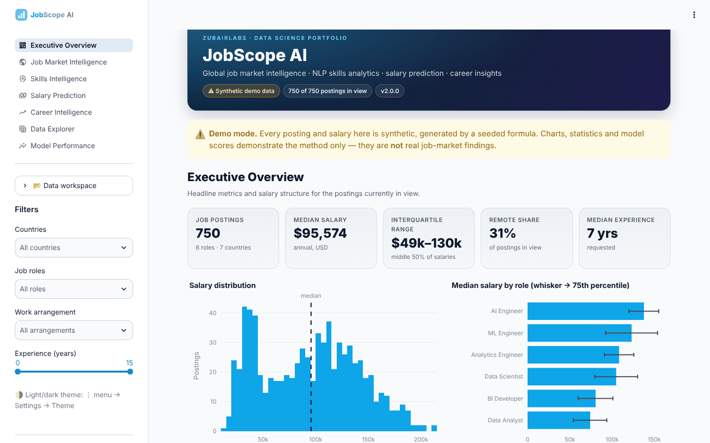
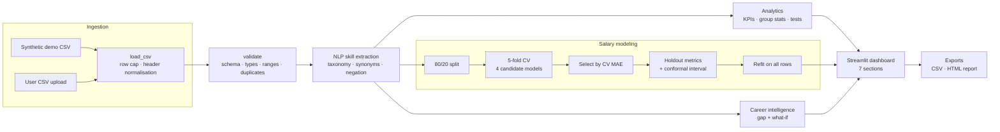
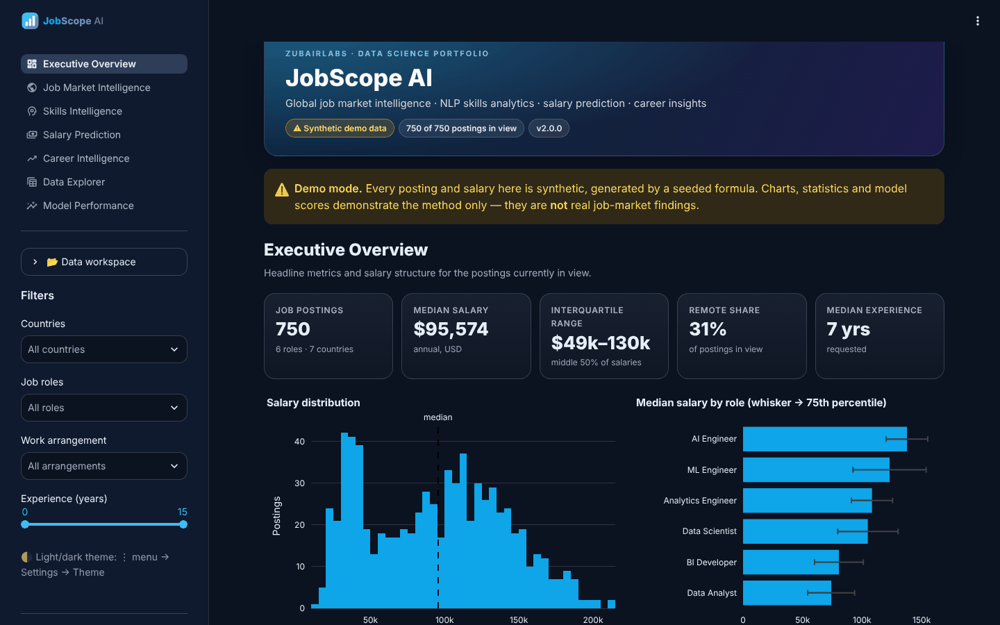
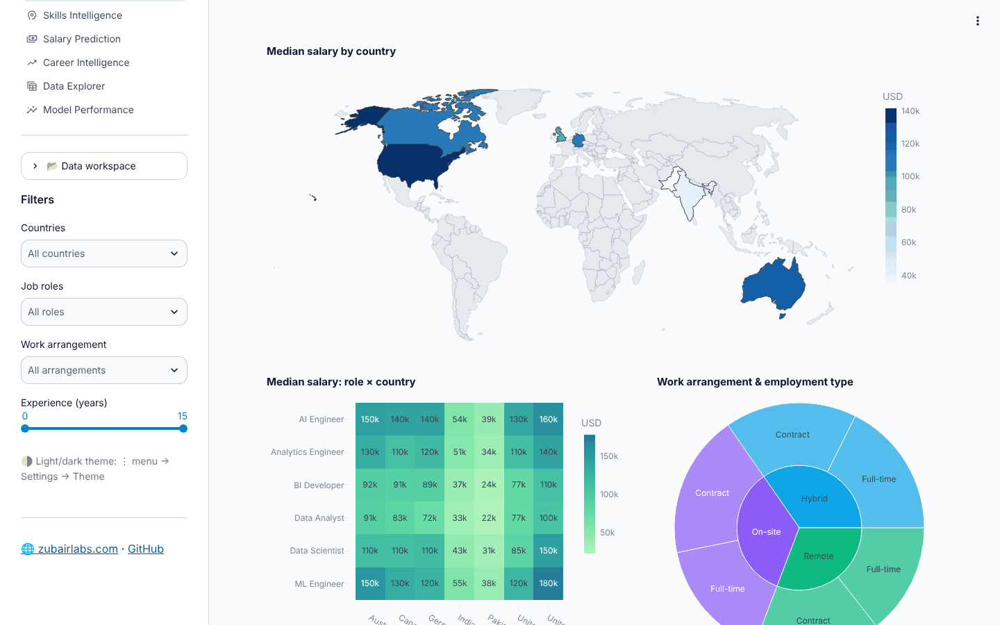
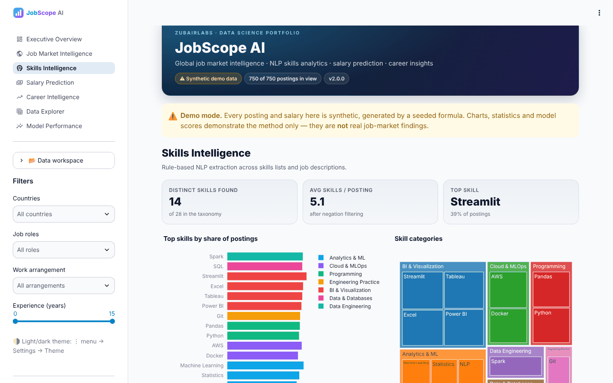
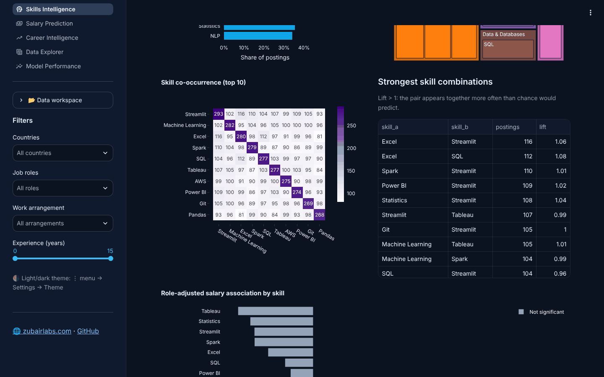
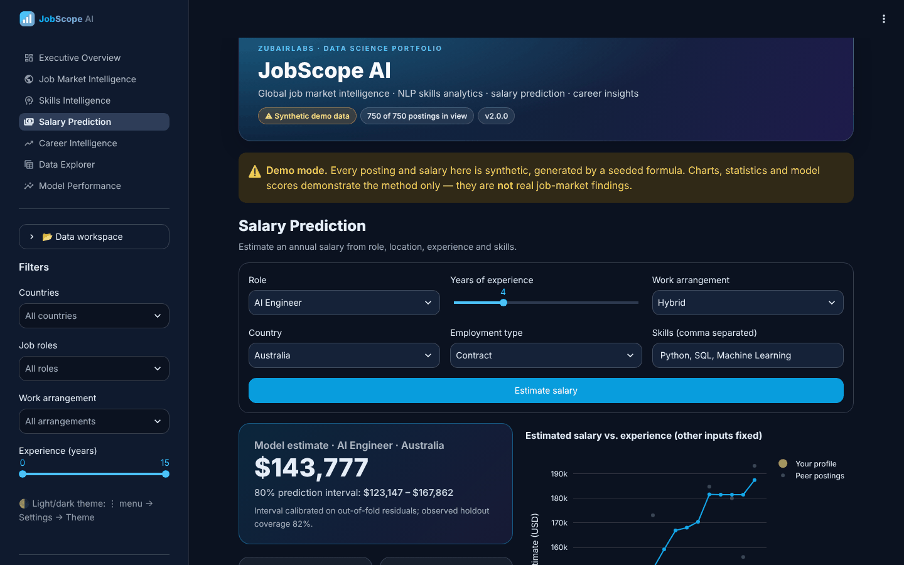
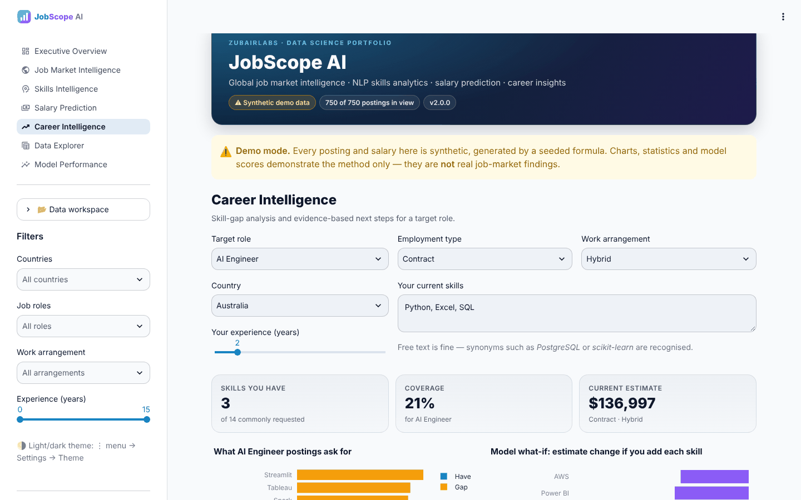
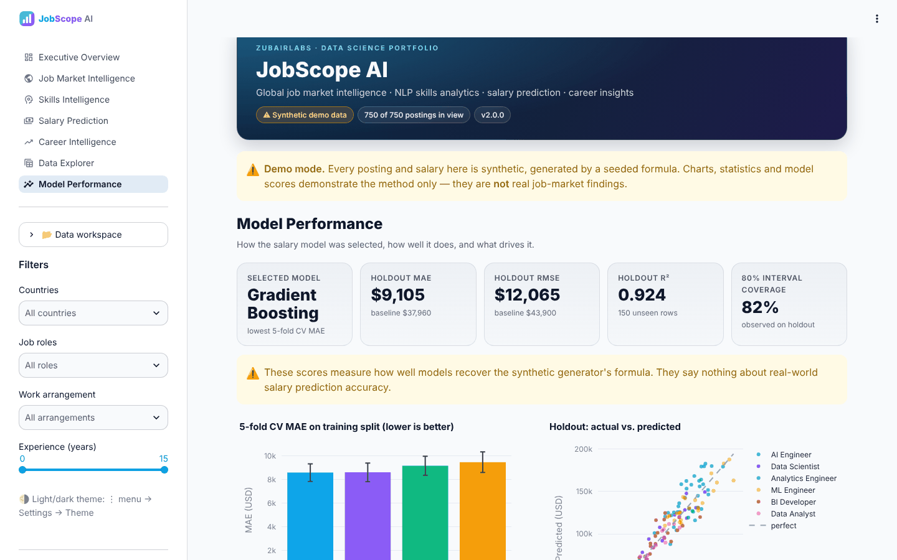
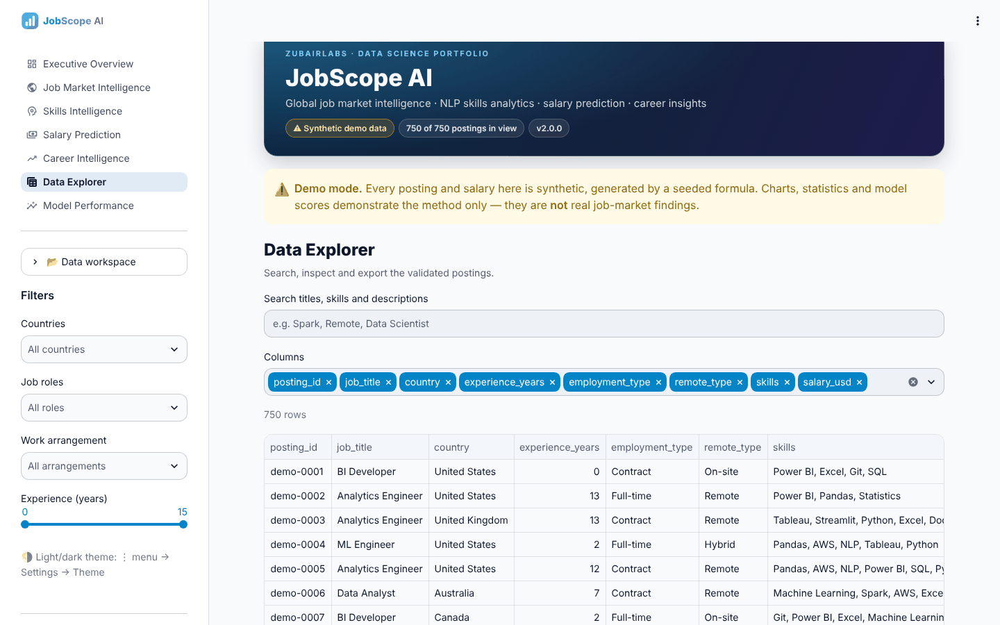

<div align="center">


# JobScope AI
### Global Job Market Intelligence & Salary Prediction

**Explore roles · understand skills demand · model compensation · plan career moves**

[](https://github.com/muhammadzubair-data/job-market-intelligence-salary-prediction/actions/workflows/ci.yml)
[](https://jobscope-ai-zubairlabs.streamlit.app)
[](https://www.python.org)
[](https://scikit-learn.org)
[](https://plotly.com/python/)
[](#-testing)
[](LICENSE)

An end-to-end data science portfolio project by **[ZubairLabs](https://zubairlabs.com)**



</div>

> [!IMPORTANT]
> **The bundled dataset is 100% synthetic.** It was generated by a seeded formula (`jobscope/data.py`) to demonstrate the pipeline. Its salaries, skill frequencies, statistical tests and model scores are **not** findings about the real job market. Upload your own properly licensed, normalised job-postings CSV to analyse real data. The app labels which mode it is in on every page.

---

## 📑 Contents

1. [Executive overview](#-executive-overview) · 2. [Business problem](#-business-problem--objectives) · 3. [Features](#-features) · 4. [Tech stack](#-technology-stack) · 5. [Architecture](#-system-architecture) · 6. [Data pipeline](#-data-pipeline) · 7. [Dataset](#-dataset) · 8. [ML methodology](#-machine-learning-methodology) · 9. [NLP methodology](#-nlp-methodology) · 10. [Results](#-model-evaluation-results) · 11. [Screenshots](#-dashboard-screenshots) · 12. [Installation](#-installation) · 13. [Run locally](#-run-locally) · 14. [Deployment](#-deploy-to-streamlit-community-cloud) · 15. [Testing](#-testing) · 16. [Structure](#-repository-structure) · 17. [Limitations](#-known-limitations) · 18. [Roadmap](#-roadmap) · 19. [Author](#-author)

---

## 🌐 Live demo

**▶ [jobscope-ai-zubairlabs.streamlit.app](https://jobscope-ai-zubairlabs.streamlit.app)**, deployed on Streamlit Community Cloud from the `main` branch (Python 3.12). If the app has been idle it may take a few seconds to wake up.

## 🧭 Executive overview

JobScope AI turns a table of job postings into an interactive analytics product. It validates and cleans the data, extracts skills from free text with a transparent NLP layer, runs statistical tests, compares four regression models with cross-validation, and serves calibrated salary estimates, skill-gap analysis and downloadable reports in a seven-section Streamlit dashboard with light and dark themes.

Everything runs on open-source Python. No paid APIs, keys or external services are required.

## 🎯 Business problem & objectives

Job seekers, recruiters and workforce analysts all ask the same questions: *Which roles are in demand? Which skills appear most often? What does a role pay in a given country at a given seniority, and how certain is that number?* Raw postings make this hard. Titles vary, salaries mix currencies and periods, and skills are buried in prose.

| Objective | How JobScope AI addresses it |
|:--|:--|
| Trustworthy inputs | Schema, type, range and duplicate validation with a visible data-quality report |
| Market visibility | KPIs, distributions, role × country heat maps, a world map and experience curves |
| Skills intelligence | Synonym-aware, negation-aware skill extraction; frequency, co-occurrence and lift |
| Compensation modelling | Four models compared by 5-fold CV; holdout metrics against a naive baseline |
| Honest uncertainty | Conformal prediction intervals with coverage measured on unseen data |
| Actionable guidance | Skill-gap analysis and model what-if scenarios for a target role |
| Shareable output | Filtered CSV, skill CSV and a self-contained HTML report |

## ✨ Features

| Dashboard section | What it shows |
|:--|:--|
| 📊 **Executive Overview** | Posting count, median salary, IQR, remote share, salary histogram, role medians with P75 whiskers, auto-generated observations, data-quality report |
| 🌍 **Job Market Intelligence** | Role demand, salary by experience band, world choropleth of median salary, role × country heat map, work-arrangement sunburst, Kruskal-Wallis and Spearman tests |
| 🧠 **Skills Intelligence** | Top skills by share, category treemap, co-occurrence matrix, skill pairs with lift, role-adjusted salary association with FDR correction, live skill-extractor playground |
| 💰 **Salary Prediction** | Interactive form, point estimate with an 80% prediction interval, peer median, experience curve against peer postings |
| 🚀 **Career Intelligence** | Have/gap chart for a target role, model what-if for each missing skill, plain-language recommendations with materiality threshold |
| 🗂️ **Data Explorer** | Full-text search, column picker, formatted table, CSV / skill CSV / HTML report downloads |
| 📈 **Model Performance** | CV comparison, holdout comparison vs. baseline, actual-vs-predicted, residuals, permutation importance, error by role and country, methodology |

Shared across pages: sidebar filters (country, role, work arrangement, experience range), CSV upload with a downloadable template, light/dark themes, ZubairLabs branding.

## 🧰 Technology stack

| Layer | Tools |
|:--|:--|
| Language | Python 3.11+ |
| Data | pandas, NumPy |
| Statistics | SciPy (Kruskal-Wallis, Spearman, Mann-Whitney U), Benjamini-Hochberg FDR |
| Machine learning | scikit-learn: Pipelines, ColumnTransformer, Ridge, RandomForest, GradientBoosting, HistGradientBoosting, permutation importance |
| NLP | Rule-based extraction over a 28-skill taxonomy with synonyms and negation handling (`re`) |
| Visualisation | Plotly (bar, box, histogram, choropleth, heat map, treemap, sunburst, scatter) |
| App | Streamlit multipage navigation, native light/dark theming, caching |
| Quality | pytest (46 tests), Streamlit AppTest, Playwright browser E2E, ruff |
| CI/CD | GitHub Actions (Python 3.11–3.13 matrix + E2E job), Streamlit Community Cloud |

## 🏗️ System architecture



More detail: [docs/ARCHITECTURE.md](docs/ARCHITECTURE.md).

## 🔄 Data pipeline

| Step | Module | Description |
|:--|:--|:--|
| 1. Ingestion | `jobscope/data.py` | Bundled synthetic CSV or uploaded CSV (25 MB / 100k-row cap, header normalisation, friendly parse errors) |
| 2. Validation | `jobscope/validation.py` | Required columns, numeric coercion, salary ∈ (0, 1M] USD, experience ∈ [0, 60], text cleanup, duplicate removal, `QualityReport` |
| 3. EDA | `jobscope/analysis.py` | KPIs, salary by group with quartiles, experience bands |
| 4. Feature engineering | `jobscope/modeling.py` | One-hot categories, scaled numerics, multi-hot canonical skills (`SkillBinarizer`) |
| 5. Statistics | `jobscope/analysis.py` | Kruskal-Wallis (ε² effect size), Spearman ρ, role-adjusted Mann-Whitney tests with FDR |
| 6. NLP | `jobscope/nlp.py` | Skill extraction, frequency, co-occurrence, lift |
| 7–9. Train, evaluate, explain | `jobscope/modeling.py` | CV comparison, holdout, conformal interval, permutation importance, group error |
| 10. Persistence | `jobscope/modeling.py`, `scripts/train.py` | `joblib` model bundle + JSON/CSV metrics in `artifacts/` |
| 11. Dashboard | `app.py` | Seven-section Streamlit app with cached data and models |
| 12. Reports | `jobscope/reports.py` | Formula-safe CSV and a self-contained HTML report |

## 🗃️ Dataset

**Bundled data:** `data/demo_jobs.csv`, 750 synthetic postings (6 roles × 7 countries, 0–15 years of experience), generated with seed 42 by `jobscope.data.generate_demo`. A test checks that the committed CSV matches the generator exactly. Every row has `source = "SYNTHETIC DEMO"`, which is how the app detects demo mode.

How the synthetic salary is generated (so you know exactly what the models can learn):

```text
salary = (role_base + 3,900 × years) × country_factor × (1.04 if Remote) × Uniform(0.82, 1.18)
```

Skills are sampled at random and **do not affect salary**, so the expected result is that skill features carry almost no importance. That is what the model finds.

**Your own data** needs these columns (case-insensitive). The full data dictionary is in [data/README.md](data/README.md):

```csv
job_title,country,experience_years,employment_type,remote_type,skills,description,salary_usd
Data Scientist,Canada,4,Full-time,Hybrid,"Python, SQL, Statistics","Build predictive models and dashboards",105000
```

`salary_usd` must be an **annual amount in USD**. Convert hourly or monthly pay and other currencies before uploading, and record the exchange-rate date. No real-world dataset is shipped because none with a clear redistribution licence was integrated. See the data README for vetted options and attribution guidance.

## 🤖 Machine learning methodology

| Decision | Choice and reason |
|:--|:--|
| Target | `log1p(salary)` via `TransformedTargetRegressor`, because country and role effects are multiplicative; predictions are returned in USD |
| Features | `job_title`, `country`, `employment_type`, `remote_type` (one-hot, rare levels grouped), `experience_years`, `skill_count` (scaled), canonical skills (multi-hot) |
| Excluded | `description` (free text could echo pay information) and the target, so there is no target leakage |
| Split | One seeded 80/20 split **before** any fitting; exact duplicates removed first so copies can't straddle the split |
| Preprocessing | All inside a scikit-learn `Pipeline`, learned on training folds only (including the skill vocabulary) |
| Candidates | Ridge, Random Forest, Gradient Boosting, HistGradientBoosting, plus a median baseline for reference |
| Selection | Lowest mean 5-fold CV MAE on the training split; the holdout is used only for reporting |
| Uncertainty | Split-conformal interval on the log scale from out-of-fold residuals; empirical coverage checked on the holdout |
| Explainability | Permutation importance on the holdout, error by role/country, experience curves, skill what-if |
| Deployment | The selected pipeline is refit on all valid rows and cached in the app; `scripts/train.py` saves it to `artifacts/` |

Full assumptions and caveats: [docs/MODEL_CARD.md](docs/MODEL_CARD.md).

## 🔤 NLP methodology

JobScope uses **transparent, rule-based extraction** instead of a black-box model, so every match can be explained:

- **Taxonomy:** 28 canonical skills in 8 categories, each with aliases (e.g. *PostgreSQL / MySQL / T-SQL → SQL*, *PySpark / Databricks → Spark*, *scikit-learn → Machine Learning*, *k8s → Kubernetes*).
- **Matching:** normalised lowercase text with word-boundary regexes, so *digital* doesn't match *Git* and *restaurant* doesn't match *R*.
- **Negation:** simple patterns such as *"no Tableau required"* or *"Spark is not required"* are not counted, unless the skill is also mentioned positively elsewhere.
- **Analytics:** share of postings, category treemap, co-occurrence matrix and **lift** (observed ÷ expected co-occurrence).
- **Salary association:** salaries are first divided by their role median so skills common in well-paid roles aren't automatically flagged. Each skill is then tested with Mann-Whitney U and corrected for multiple testing with Benjamini-Hochberg.

You can try the extractor on your own text in the **Skills Intelligence** page.

## 📏 Model evaluation results

Measured by `python scripts/train.py` on the **synthetic** demo data (750 rows → 600 train / 150 holdout, seed 42). These numbers show the models recovering the generator's formula. **They are not evidence of real-world predictive accuracy.**

**5-fold cross-validation on the training split (used for selection)**

| Model | CV MAE (USD) | ± std | CV RMSE (USD) | CV R² |
|:--|--:|--:|--:|--:|
| **Gradient Boosting** ✅ selected | **8,572** | 740 | 11,328 | 0.941 |
| Ridge Regression | 8,591 | 793 | 11,174 | 0.942 |
| HistGradientBoosting | 9,151 | 800 | 12,071 | 0.933 |
| Random Forest | 9,455 | 862 | 12,368 | 0.930 |

**Holdout (20%, reported once)**

| Model | MAE (USD) | RMSE (USD) | R² |
|:--|--:|--:|--:|
| Baseline (predict median) | 37,960 | 43,900 | −0.003 |
| Ridge Regression | 9,095 | 12,142 | 0.923 |
| Random Forest | 9,641 | 13,155 | 0.910 |
| **Gradient Boosting** (selected) | **9,105** | **12,065** | **0.924** |
| HistGradientBoosting | 9,451 | 12,562 | 0.918 |

**80% prediction interval:** observed holdout coverage **82%**.

**Reading the results honestly**

- Gradient Boosting and Ridge are within one CV standard deviation of each other. This is expected, because the synthetic salary is log-linear in the features, which suits a linear model on the log scale.
- Permutation importance ranks **country > job title > experience**, with skills near zero. That matches the generator, where skills don't influence pay.
- The selected model's MAE is about 4× lower than the naive median baseline.

## 🖼️ Dashboard screenshots

All screenshots were captured from the running app by the Playwright E2E script (`tests/e2e_ui.py --shots`).

| Executive Overview (dark) | Job Market Intelligence — world map |
|:--:|:--:|
|  |  |
| **Skills Intelligence** | **Skill co-occurrence & combinations (dark)** |
|  |  |
| **Salary Prediction (dark)** | **Career Intelligence** |
|  |  |
| **Model Performance** | **Data Explorer** |
|  |  |

## ⚙️ Installation

```bash
git clone https://github.com/muhammadzubair-data/job-market-intelligence-salary-prediction.git
cd job-market-intelligence-salary-prediction
python -m venv .venv
# Windows:      .venv\Scripts\activate
# macOS/Linux:  source .venv/bin/activate
pip install -r requirements.txt          # runtime only
pip install -r requirements-dev.txt      # + pytest, ruff, playwright (for development)
```

## ▶️ Run locally

```bash
streamlit run app.py                     # dashboard → http://localhost:8501
python scripts/train.py                  # train + compare models on the demo data
python scripts/train.py --csv my_jobs.csv --output artifacts/my_run
```

`scripts/train.py` prints the CV and holdout tables and writes `salary_model.joblib`, `metrics.json`, `cv_comparison.csv`, `holdout_comparison.csv` and `permutation_importance.csv` to `artifacts/`, which is git-ignored. Only load `.joblib` files you created yourself.

## ☁️ Deploy to Streamlit Community Cloud

1. Fork or push this repository to GitHub.
2. Go to [share.streamlit.io](https://share.streamlit.io) → **Create app** → **Deploy a public app from GitHub**.
3. Repository `muhammadzubair-data/job-market-intelligence-salary-prediction`, branch `main`, main file `app.py`.
4. Optionally choose Python 3.12 under **Advanced settings**. No secrets are needed.
5. **Deploy.** The first model training takes about 10 seconds and is cached afterwards.

Details and troubleshooting: [docs/DEPLOYMENT.md](docs/DEPLOYMENT.md).

## 🧪 Testing

```bash
python -m pytest -q                      # 46 unit + integration tests
ruff check .                             # lint
streamlit run app.py &                   # then, in another shell:
python tests/e2e_ui.py http://localhost:8501   # browser E2E (needs `playwright install chromium`)
```

| Suite | Covers |
|:--|:--|
| `test_data_validation.py` | Demo CSV matches generator, CSV loading (bytes, empty, row cap, headers), validation counts, edge cases |
| `test_nlp.py` | Synonyms, word boundaries, negation, frequency, pairs/lift, co-occurrence |
| `test_modeling.py` | All candidates compared, CV-based selection, baseline beaten, split integrity, interval coverage, train-only skill vocabulary, unseen categories, reproducibility, artifact round-trip |
| `test_analysis_career_reports.py` | Statistical tests, FDR, skill gap, what-if, recommendations, CSV formula-injection guard, HTML escaping |
| `test_app_integration.py` | Dashboard start-up and filter rerun (Streamlit AppTest), training CLI |
| `test_core.py` | Backward compatibility of the original v1 API |
| `e2e_ui.py` | All 7 pages in a real browser, prediction, CSV upload → user-data mode, CSV and HTML report downloads |

CI runs lint, tests and the training CLI on Python 3.11, 3.12 and 3.13, then the browser E2E job.

## 📁 Repository structure

```text
job-market-intelligence-salary-prediction/
├── app.py                        # Streamlit dashboard (7 sections)
├── jobscope/
│   ├── config.py                 # constants, schema, paths
│   ├── data.py                   # synthetic generator, safe CSV loading
│   ├── validation.py             # cleaning + QualityReport
│   ├── nlp.py                    # skill taxonomy & extraction
│   ├── analysis.py               # KPIs and statistical tests
│   ├── modeling.py               # pipelines, CV comparison, intervals, explainability, persistence
│   ├── career.py                 # skill gap, what-if, recommendations
│   ├── reports.py                # safe CSV + HTML report
│   └── core.py                   # v1 compatibility API
├── scripts/train.py              # reproducible training CLI
├── tests/                        # pytest suites, fixtures, Playwright E2E
├── data/                         # synthetic demo CSV + data dictionary
├── docs/                         # architecture, model card, case study, deployment, portfolio copy
├── assets/                       # logo, icon, real screenshots
├── static/topojson/              # bundled world map outlines (served locally)
├── .streamlit/config.toml        # light/dark themes, upload limit
├── .github/workflows/ci.yml      # CI: lint, tests, training, E2E
├── requirements.txt / requirements-dev.txt / pyproject.toml
└── LICENSE
```

## ⚠️ Known limitations

- **Synthetic demo data.** Demo results describe a formula, not the market. Real conclusions need real, licensed data.
- **Random split.** This can overstate performance for new time periods, employers or regions. Real data should use time-based or grouped validation.
- **Rule-based NLP.** It only finds skills in the taxonomy. Negation handling is simple, and context such as "nice to have" vs. "required" is not modelled.
- **Associations, not causes.** Skill premiums and what-if changes show patterns in the data, not the effect of learning a skill.
- **Salary normalisation is the uploader's job.** Mixed currencies or pay periods will distort every result.
- **Fairness.** Errors differ by country and role (see Model Performance). Audit before any decision-making use, and never add protected characteristics.
- **Map coverage.** Country names are mapped to ISO codes for about 60 countries. Others still appear in charts and tables but not on the map, and the app lists them.

## 🗺️ Roadmap

- [x] Validation pipeline with quality report
- [x] Synonym- and negation-aware skill extraction
- [x] Four-model CV comparison with baseline
- [x] Conformal prediction intervals
- [x] Permutation importance and group error analysis
- [x] Career gap and what-if analysis
- [x] HTML report export and CSV injection guard
- [x] CI on 3 Python versions + browser E2E
- [ ] Licensed real job-postings dataset with provenance tracking
- [ ] Time-based validation and drift monitoring
- [ ] SHAP local explanations
- [ ] Multi-currency normalisation with dated FX rates
- [ ] Embedding-based skill matching for out-of-taxonomy skills

## 👤 Author

**Muhammad Zubair** — Data Scientist & founder of ZubairLabs

[](https://zubairlabs.com)
[](https://github.com/muhammadzubair-data)
[](https://www.linkedin.com/in/xubbiofficial/)
[](https://www.upwork.com/freelancers/xubbiofficial)

Released under the [MIT License](LICENSE). Issues and suggestions are welcome.
