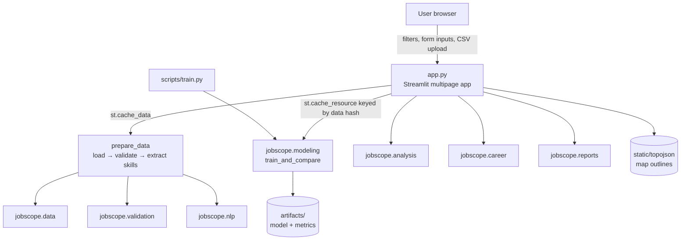

# Architecture

## Modules

| Module | Responsibility | Key functions |
|:--|:--|:--|
| `config.py` | Schema, constants, paths, country → ISO-3 map | `REQUIRED_COLUMNS`, `MODEL_FEATURES` |
| `data.py` | Seeded synthetic generator and guarded CSV loading | `generate_demo`, `load_demo`, `load_csv` |
| `validation.py` | Cleaning rules and data-quality accounting | `validate`, `QualityReport`, `is_synthetic` |
| `nlp.py` | Skill taxonomy, extraction, frequency, co-occurrence | `extract_skills`, `skill_frequency`, `skill_pairs` |
| `analysis.py` | KPIs, grouped stats, hypothesis tests, FDR | `kpis`, `salary_by`, `statistical_summary`, `skill_salary_association` |
| `modeling.py` | Pipelines, CV comparison, holdout, conformal interval, importance, persistence | `train_and_compare`, `predict_with_interval`, `save_artifacts` |
| `career.py` | Skill gap, what-if, experience curve, recommendations | `skill_gap`, `skill_what_if`, `recommendations` |
| `reports.py` | Formula-safe CSV, self-contained HTML report | `to_csv_bytes`, `build_html_report` |
| `core.py` | v1 API kept for backward compatibility | `validate`, `train`, `predict_salary` |

## Runtime behaviour

- **Caching.** Parsed and validated data is cached per uploaded file. The trained model is cached per SHA-256 fingerprint of the data, so filters never retrain the model and a new upload trains a new one once.
- **Filters vs. model.** Sidebar filters change the analytics views only. The salary model always trains on the full validated dataset so predictions don't change with what's on screen.
- **Failure handling.** An unreadable or invalid upload shows a clear error and falls back to the demo data. Too few rows for modelling (< 60) shows a warning on model pages while the analytics pages still work.
- **Security.** Upload size is capped (25 MB / 100k rows). Values inserted into custom HTML are escaped. CSV exports neutralise spreadsheet formulas. XSRF protection stays on. No secrets are used. `joblib` files are only produced locally and never loaded from users.
- **Offline maps.** World outlines (`static/topojson/world_110m.json`, MIT-licensed from `sane-topojson`) are served by Streamlit static serving, so the choropleth doesn't depend on a CDN.
